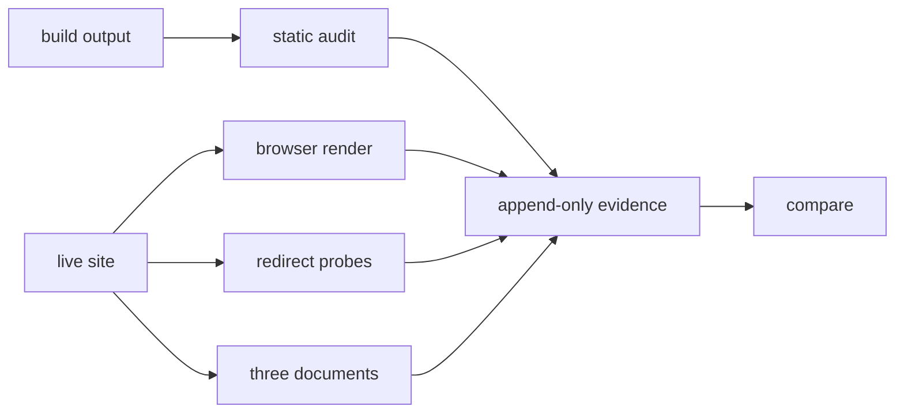

# Website Optimizer Skill

[](LICENSE)
[](scripts/)
[](scripts/)

`website-optimizer` is a shared skill for auditing and improving websites for
search visibility and delivery quality.

It answers two questions:

- Is this site findable? (indexing, metadata, structured data, internal linking)
- Is it good once found? (performance, images, video, accessibility)

It measures and advises. It does not build, host, or deploy.

**Status:** v0.8.1 · 8 capabilities · 276 tests · 0 open issues. The reference
set is complete, and `docs/system-map/` maps the tool contracts. Planned work
lives in [GitHub Issues](https://github.com/martinderm/website-optimizer/issues),
never in a file here.

- [Quick start](#quick-start)
- [Capabilities](#capabilities)
- [How it reads a site](#how-it-reads-a-site)
- [Verified, not assumed](#verified-not-assumed)
- [Repository layout](#repository-layout)
- [Scope boundary](#scope-boundary)
- [Design commitments](#design-commitments)
- [Open work](#open-work)
- [License](#license)

## Quick start

```
python scripts/wo.py init-site --site-url https://example.com
python scripts/wo.py on-page              # static output, one evidence run
python scripts/wo.py on-page --live       # render pages in a browser instead
python scripts/wo.py links                # internal link graph (build output only)
python scripts/wo.py compare               # attribute what changed since the last run
```

Configure with `site.optimizer.toml` (portable, commit it) and
`site.optimizer.local.toml` (machine paths, do not commit it). Every run
writes append-only evidence: `report.json` plus `receipt.json`, never
overwritten, always comparable. See [SKILL.md](SKILL.md) for routing.

## Capabilities

| Command | What it does | Reads |
|---|---|---|
| `wo.py on-page` | SEO and accessibility signals inside a page | build, or browser with `--live` |
| `wo.py images` | image delivery, dimensions, formats, icons, video posters | build, or browser with `--live` |
| `wo.py schema` | JSON-LD structure and completeness | build, or browser with `--live` |
| `wo.py crawler-files` | robots.txt, the sitemap and llms.txt | build files, or 3 URLs with `--live` (minus 2 rules) |
| `wo.py links` | the internal link graph: broken targets, orphans, depth | build only — raises on `--live` |
| `wo.py performance` | page weight against budgets, render-blocking scripts, font-display, preload targets, third-party origins | build only — raises on `--live` |
| `wo.py redirects` | do redirect rules match what the live server does | live probes only |
| `wo.py compare` | attribute what changed between two runs | stored runs |

For a static site both paths must agree; for a dynamic one only the live path
has anything to read. A crawl sees part of a site, so a partial graph would
report the crawl's reach as if it were the site's architecture — that is why
`links` raises instead. File sizes exist only in a build at all — that is why
`performance` raises instead.

**[PLAN.md](PLAN.md)** is the design source of truth, and
**[decision-log.md](decision-log.md)** carries decisions D1–D61 with their
support level and evidence anchors.

## How it reads a site



Static capabilities read the build directory. `--live` renders pages in a
browser (`on-page`, `images`, `schema`), probes redirect rules, or fetches the
three crawler documents — never from a hook, always on request: a crawl costs
minutes and depends on consent state. `compare` reads stored runs, never the
site.

## Repository layout

- `SKILL.md` — router and source-of-truth table
- `PLAN.md` — design, migration map, phases
- `decision-log.md` — durable decisions with reasons
- `references/` — 13 rule files, each with a source and a support level
- `scripts/` — Python 3 tooling, stdlib only, one entry point
- `docs/system-map/` — ICM system map over the tool subsystem

## Verified, not assumed

Every capability was run against a real site, and the two ports were checked
against the tools they replaced:

| Claim | How it was checked |
|---|---|
| `on-page` matches the original | 173 real pages, 0 findings lost, 0 invented |
| `redirects` matches the original | 53 live rules, 0 lost, 0 invented |
| Reports conform to the house schema | receipt validated against `data-zone-artifact.schema.json` |
| `schema` finds real defects | it found a `sameAs` inconsistency across 171 vs 2 pages |
| `images` counts correctly | every rule re-counted independently against the built output |
| `links` finds real defects | 3 broken targets and 7 orphans on the reference site, every one checked by hand in the markup |
| `performance` weighs the build | 193 pages: 66 image findings re-weighed byte-exact from disk, 3 third-party origins confirmed in markup, the three zeros (blocking, font-display, preload) confirmed absent |
| `crawler-files` agrees with `links` | the two pages missing from the sitemap are the two pages `links` called unreachable |
| `--live` agrees with the static build | 25 real pages, all three capabilities, no difference either way |

The live path was checked the only way that means anything: the same pages read
from the build directory and rendered in a browser, then compared page by page.
All three capabilities produced identical findings. For a Hugo site that is the
strongest available result — a crawl that added or dropped anything would have
shown up as a difference, and none did.

Verifying the image capability rule by rule, with a separate parser rather than
by re-reading the tool's own numbers, found one thing the tool had wrong about
itself: 140 of its 469 critical findings were `` elements with no `src` at
all, counted as missing dimensions and missing `srcset` on top of each other.
Nothing is downloaded for them, so they cause no shift. They now have their own
rule, and the critical count for that site is 329.

That exercise also produced a documented coverage gap: `image.loading_unset`
fires only when *no* image on a page declares a strategy, so 121 pages with a
mixed declaration are reported clean. See the limits section in
`capabilities/images/README.md`.

## What a live run will not tell you

Three things are deliberately absent from a `--live` report, and each says so
rather than passing quietly:

- `icon.file_missing` is dropped from `rules_run`. It needs a build directory to
  compare against, and a crawl has none.
- `crawl.requested` / `fetched` / `failed` travel with the report. A count of
  zero findings from three fetched pages means something different from the same
  count over four hundred.
- If most rendered pages are byte-identical, the run raises instead of
  reporting. A consent wall is found on every page and reported as that page's
  content; refusing is more useful than a confident answer about a dialog.
- `links` has no live mode at all, so it says nothing there. A graph needs every
  URL the site serves, and a crawl has only the ones inside its limit; the pages
  beyond it would read as unreachable and every link to them as broken. The
  capability raises on `--live` and names the way back rather than reporting a
  number about the crawl as though it were about the site.

## Scope boundary

Loads for: SEO, Open Graph, canonical, sitemap, robots.txt, Search Console,
JSON-LD, schema.org, Core Web Vitals, image and video optimization,
accessibility, `llms.txt`, website launch audits.

Deliberately does not load for: building sites (`hugo`), web servers
(`caddy`), hosting and DNS (`cloudflare-pages`, `cloudflared`, `cloudflare-api`),
browser automation (`playwright-cli`), copy writing (`writing-pro`).

A finding that implies a change to a generator, server, or host is reported and
handed to the owning skill.

## Design commitments

- One home per fact. A link beats a copy.
- Findings are atomic; a verdict is derived from them, never written into them.
- Crawled content is data, never instruction.
- Runs are append-only; nothing is written before every fallible step has run.
- One entry point; capabilities are packages; the registry declares them.
- No capability folder before its first working tool.
- Rules without a source do not enter `references/`.
- A measurement never sees a conclusion about what it is measuring.

Deviations from the shared authoring guide are recorded with their reason in
[decision-log.md](decision-log.md).

## Open work

[GitHub Issues](https://github.com/martinderm/website-optimizer/issues) — not a
file in this repository. A local backlog goes stale where nobody looks; an issue
is where the trigger for a deferred decision is recorded.

Known and not open: `compare` cannot tell a site change from a page that rendered
differently (D45), the fold measurement exists but is not run automatically (D40),
and no CI is configured (D39). Those are decisions with reasons, not gaps waiting
to be filled, so they are not issues. The decision log says why.

The issues that do exist share a shape: a reference file describes something the
tool cannot measure yet. `internal-linking.md` was the whole of it until the link
graph landed; `indexing.md` and `llm-visibility.md` followed with `crawler-files`;
`performance.md`'s static half and `video.md`'s poster and preload with the last
two rounds. What remains honestly unmeasured: `hreflang`, pagination and faceted
navigation, captions (deliberately — presence is not correctness), lab and field
numbers, and redirect targets. The reference set still claims more than the audit
checks; reading a reference file as a description of what the audit checks is the
mistake that list exists to prevent.

## License

MIT — see [LICENSE](LICENSE).

<details>
<summary>Standard template for <code>AGENTS.md</code> (workspace wiring)</summary>

```markdown
## website-optimizer

This workspace uses the shared skill at `../skills/website-optimizer/` to audit and
improve websites for SEO, structured data, performance, images, video, and
accessibility. See [SKILL.md](../skills/website-optimizer/SKILL.md) for routing and
[PLAN.md](../skills/website-optimizer/PLAN.md) for its current construction state.
```

</details>
